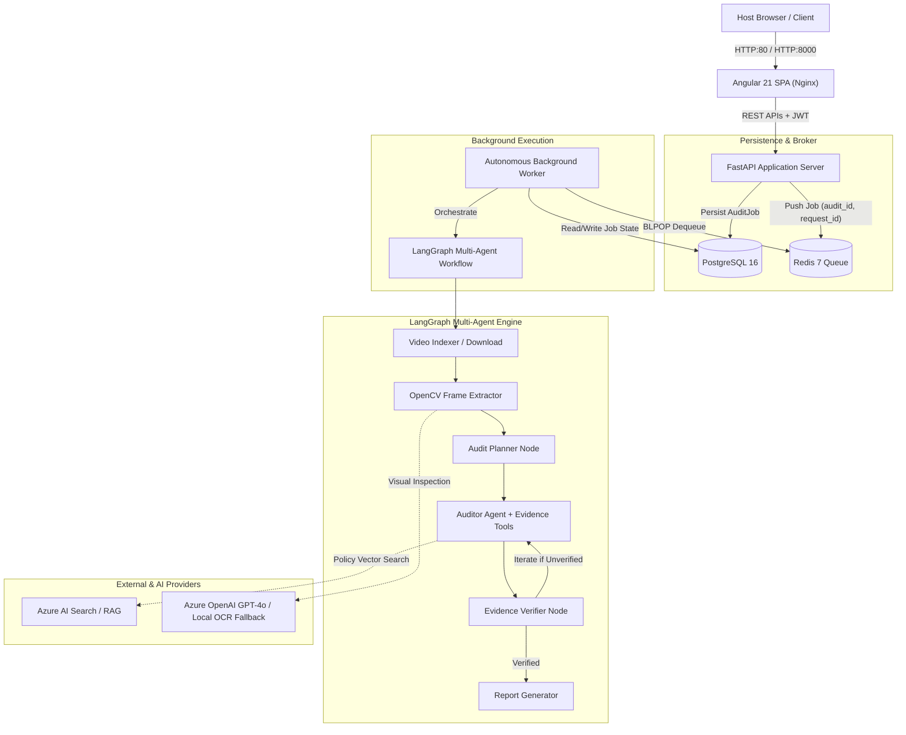
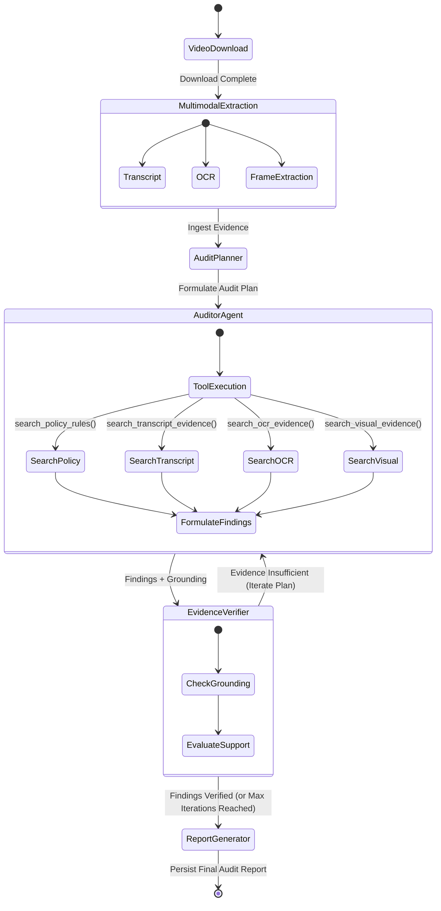

# Brand Guardian AI

> An agentic multimodal video compliance auditing system that analyzes video content against advertising and influencer policy requirements using evidence retrieval, temporal/visual grounding, verifier-guided reasoning, and asynchronous processing.

[](#evaluation-results)
[](#frontend)
[](https://www.python.org/)
[](https://angular.dev/)
[](https://fastapi.tiangolo.com/)
[](https://github.com/langchain-ai/langgraph)
[](#observability)
[-orange)](#docker-architecture)

---

## Overview

**Brand Guardian AI** inspects video advertisements and sponsored influencer content to detect non-compliance with regulatory and brand safety guidelines (such as FTC disclosure rules, UK ASA regulations, and competitive brand conflicts). 

Instead of treating video auditing as a single ungrounded Large Language Model (LLM) prompt, the platform decomposes compliance analysis into a **stateful, multimodal multi-agent workflow** with independent evidence extraction, policy tool retrieval, reflection verification, and decoupled asynchronous execution.

---

## Why This Project Exists

1. **The Short-Form Video Explosion**: Brands sponsor thousands of creator videos monthly across YouTube, TikTok, and Instagram. Manual auditing for required disclosures (`#ad`, `#sponsored`, verbal callouts, clear visual placement) is cost-prohibitive and slow.
2. **The LLM Hallucination Trap**: Passing an entire video transcript directly to a generic LLM frequently yields hallucinations, missing timestamps, and false accusations of non-compliance.
3. **Multimodal Reality**: Compliance disclosures are rarely purely verbal. A creator might disclose sponsorship via fleeting onscreen text (OCR), a verbal aside (Audio Transcript), or a brand badge (Visual Object). Auditing requires cross-referencing all three channels synchronously against formal regulatory statutes.

---

## Key Capabilities

* **Multimodal Tri-Channel Grounding**: Extracts and synchronizes timestamped audio transcripts, onscreen text (OCR), and extracted video frames.
* **Agentic Audit Planning & Evidence Tooling**: An Audit Planner generates targeted compliance hypotheses, dynamically invoking specialized search tools for policy corpora, transcript ranges, OCR bounding text, and visual observations.
* **Reflective Verification Node**: An independent Verifier evaluates auditor findings against retrieved evidence before report synthesis. Unsupported findings trigger bounded iterative refinement loops.
* **High-Throughput Asynchronous Architecture**: FastAPI receives requests, commits to PostgreSQL, and dispatches jobs to a persistent Redis queue processed by an autonomous background worker.
* **Enterprise Security & IDOR Defense**: Stateless JWT authentication, role-based access control (`USER` vs `ADMIN`), server-side audit and evaluation ownership isolation, anti-SSRF protections, and hardened security headers.
* **Deep Observability & Log Redaction**: End-to-end correlation tracking (`X-Request-ID` $\rightarrow$ `audit_id` $\rightarrow$ `worker_id`), structured JSON logging, stage latency profiling, and automated log sanitization that scrubs tokens, passwords, and connection strings.
* **Independent Evaluation Framework**: Reproducible benchmarking suite evaluating finding precision, recall, grounding rates, citation completeness, and verifier agreement.

---

## Architecture

The system is organized as a decoupled microservice topology:



---

## Agentic Workflow



### Workflow Mechanics
1. **Audit Planner**: Analyzes multimodal metadata to construct a structured inspection plan specifying which regulations (e.g., FTC 16 CFR Part 255) must be investigated.
2. **Evidence Tools**: The Auditor does not ingest massive video files directly. It queries discrete tools (`search_policy_rules`, `search_transcript_evidence`, `search_ocr_evidence`, `search_visual_evidence`) to retrieve timestamped snippets.
3. **Evidence Verifier**: Acts as a reflection node. It cross-checks each finding's timestamp and visual claim against concrete tool outputs. If a finding claims "No disclosure displayed," but the OCR search shows `#ad` on screen at `00:03`, the verifier rejects the finding and loops back.
4. **Bounded Iterative Reasoning**: Graph execution limits loops (default maximum 2 iterations) to prevent infinite reasoning cycles and runaway LLM costs.
5. **Report Generator**: Generates the final audit record only after findings have passed verification.

---

## Why This Is Agentic

| Dimension | Traditional Sequential Script | Brand Guardian AI (Agentic Workflow) |
| :--- | :--- | :--- |
| **Execution Flow** | Hardcoded, linear pipeline ($A \rightarrow B \rightarrow C$). | Dynamic directed acyclic graph with conditional branching and loops. |
| **Information Access** | Shovels entire transcripts/blobs into a single prompt. | Granular tool-driven queries over policy corpora and evidence indices. |
| **Error Handling** | Blind acceptance of LLM output or pipeline crash on exception. | Verifier reflection node validates assertions and orders re-investigation. |
| **Reasoning Boundary** | Single-pass generation prone to confabulation. | Bounded iterative refinement with stateful graph memory across iterations. |
| **Output Integrity** | Ungrounded subjective text. | Strict Pydantic models requiring temporal timestamps and policy citations. |

> *Engineering Note*: Agentic behavior in Brand Guardian AI refers to **deterministic graph routing, dynamic tool invocation, stateful reasoning, and automated reflection**—not unconstrained autonomous decision-making.

---

## Multimodal Evidence

Brand Guardian AI operates across three distinct sensory channels:

```text
┌────────────────────────────────────────────────────────────────────────┐
│                        TRI-CHANNEL GROUNDING                           │
├──────────────────┬─────────────────────────┬───────────────────────────┤
│ 1. TRANSCRIPT    │ 2. OCR (ON-SCREEN TEXT) │ 3. VISUAL FRAMES          │
│ Spoken audio     │ Burned-in video text    │ High-resolution frames    │
│ Timestamped cues │ Bounding boxes & times  │ Scene & object inspection │
└──────────────────┴─────────────────────────┴───────────────────────────┘
```

### Execution Modes
* **`NATIVE_VISION`**: Utilizes Azure OpenAI GPT-4o multi-frame analysis to inspect extracted keyframes for sponsor logos, subtle product placements, and visual text.
* **`DEGRADED_OCR_FALLBACK`**: If cloud vision credentials are absent, the pipeline automatically falls back to local OpenCV and OCR frame inspection. 
  - *Integrity Rule*: Telemetry explicitly records `audit_degraded_mode` (`DEGRADED_OCR_FALLBACK`). Degraded OCR is never misrepresented as full visual reasoning.

---

## Async Processing

Video analysis takes time (downloading, frame extraction, LLM reflection). To prevent HTTP gateway timeouts and resource exhaustion:

1. **Client Request**: `POST /audits` validates the video URL, creates a database job with status `QUEUED`, and returns `202 Accepted` with an `audit_id`.
2. **Broker Dispatch**: The API enqueues `{ "audit_id": "...", "request_id": "..." }` into Redis.
3. **Decoupled Worker**: An independent Python worker daemon (`WorkerDaemon`) polls Redis using `BLPOP`, sets up execution correlation, processes the LangGraph pipeline, and writes results to PostgreSQL.
4. **Resilience**: Redis disconnection triggers graceful retry loops; jobs failing unexpectedly are caught and marked `FAILED` with sanitized error codes.

---

## Evaluation Framework

Brand Guardian AI includes an independent, reproducible evaluation engine (`backend/evaluation/`) that benchmarks compliance audit quality against manually labeled test fixtures.

### Reference Benchmark ($N=6$, Dataset `v1`)

```text
Dataset Version:       v1 (MANUALLY_CURATED)
Cases Evaluated (N):   6
Execution Modes:       NATIVE_VISION (5), DEGRADED_OCR_FALLBACK (1)
Mean Latency:          8.10s (Min: 6.00s, Max: 10.40s)
```

| Evaluation Metric | Score | Definition |
| :--- | :--- | :--- |
| **Finding Precision** | **1.00** | True Positives / (True Positives + False Positives) |
| **Finding Recall** | **1.00** | True Positives / (True Positives + False Negatives) |
| **Finding F1 Score** | **1.00** | Harmonic mean of finding precision and recall |
| **Evidence Support Rate** | **1.00** | Ratio of findings substantiated by timestamped evidence |
| **Unsupported Finding Rate** | **0.00** | Hallucinated or ungrounded findings (target: 0) |
| **Citation Presence Rate** | **1.00** | Findings citing a recognized policy rule |
| **Citation Completeness** | **1.00** | Citations providing title, rule section, and text excerpt |
| **Schema Validity Rate** | **1.00** | Audit responses conforming strictly to Pydantic schemas |
| **Verifier Agreement** | **100%** | Agreement between verifier routing and expected outcome |

> [!WARNING]
> **Scientific Integrity & Benchmark Context**:
> A score of 1.00 indicates **perfect agreement across the 6 reference benchmark fixtures**. It does **NOT** prove "100% real-world accuracy" across arbitrary web videos. Benchmark datasets are manually curated, ground truth labels may have human annotation bias, and live visual evaluation is bounded by model capability.

---

## Security Architecture

* **Authentication**: Stateless JSON Web Tokens (JWT) signed via HMAC-SHA256 (`HS256`). Passwords hashed with salted `bcrypt`.
* **Authorization & RBAC**:
  - `USER`: May create audits, list their own jobs, and view their own reports.
  - `ADMIN`: Full system visibility, access to `/api/admin/observability/summary`, and authority to create official baseline evaluation runs.
  - **IDOR Protection**: All audit lookups verify server-side `created_by` ownership. Attempts by User A to access User B's audit return `404 Not Found`.
* **SSRF Defense**:
  - Validates all video URLs against IPv4/IPv6 private blocks (`10.0.0.0/8`, `172.16.0.0/12`, `192.168.0.0/16`, `127.0.0.0/8`, `169.254.0.0/16`).
  - Performs DNS resolution before fetch to prevent DNS rebinding attacks.
  - Rejects localhost, cloud metadata addresses (`169.254.169.254`, `metadata.google.internal`), and raw IPs.
  - *Documented Residual Risk*: Downstream HTTP redirects within `yt-dlp` subprocesses represent a residual risk requiring container-level egress firewall rules in production.
* **Security Headers & CORS**:
  - Strict non-wildcard CORS in production.
  - Injects `X-Content-Type-Options: nosniff`, `X-Frame-Options: DENY`, `Referrer-Policy: strict-origin-when-cross-origin`, and `X-XSS-Protection`.

---

## Observability

The platform implements production-grade structured observability designed to answer:

> *"A user submitted audit X. What happened, how long did each stage take, which agent/tool ran, what evidence was retrieved, where did it fail, which worker processed it, and what should an operator investigate?"*

### Correlation Propagation

```text
HTTP Request (X-Request-ID Header)
         │
         ▼
FastAPI Middleware (Sets ContextVar request_id, emits http_request_started)
         │
         ▼
AuditJob Model (Persists request_id in PostgreSQL)
         │
         ▼
Redis Queue (Enqueues job payload carrying audit_id and request_id)
         │
         ▼
Worker Daemon (Restores request_id, attaches worker_id: host-pid-uuid)
         │
         ▼
LangGraph Execution (Emits node_started, agent_tool_completed, verifier_completed)
```

### Structured Log Schema Example

```json
{
  "timestamp": "2026-09-23T15:30:00.123456+00:00",
  "level": "INFO",
  "event": "agent_tool_completed",
  "service": "brand-guardian-api",
  "environment": "production",
  "app_version": "3.0.0",
  "request_id": "84af1992-0b82-4ad5-9831-d8ec11ab9021",
  "audit_id": "73c66f54-8c65-4f0e-b811-309d57a9f77f",
  "worker_id": "worker_node_4210_8f91a2",
  "stage": "auditing",
  "duration_ms": 142,
  "tool_name": "search_policy_rules",
  "result_count": 3,
  "message": "Evidence tool 'search_policy_rules' returned 3 items in 142ms."
}
```

* **Automated Redaction**: A custom logging filter (`SensitiveDataRedactionFilter`) automatically masks passwords, Bearer tokens, raw JWTs, connection string passwords, and SAS query tokens before log emission.
* **Tool Data Privacy**: Evidence tools log result counts and durations—they **never** dump full evidence corpora into logs.

---

## Frontend

Built with **Angular 21** using modern reactive patterns:

* **Standalone Architecture**: 100% standalone components, signals, and inject-based dependency injection.
* **Authentication Interceptor & Route Guards**: Automatically attaches Bearer tokens to outgoing requests, catches 401 errors, and protects routes via `AuthGuard`.
* **Real-Time Progress Polling**: Polls audit execution progress with exponential backoff, stopping cleanly upon terminal status (`COMPLETED` / `FAILED`).
* **Evaluation Dashboard**: Interactive visual matrix comparing baseline runs against experimental models, displaying precision/recall curves and discrepancy reports.

---

## Docker Architecture

The repository includes a complete multi-container production topology defined in [`docker-compose.yml`](file:///d:/VIDEO_AUDIT_PROJ-20260921T163902Z-1-001/VIDEO_AUDIT_PROJ/docker-compose.yml):

```text
Services:
  ├── postgres   (PostgreSQL 16 Alpine with pg_isready healthcheck)
  ├── redis      (Redis 7 Alpine with AOF disk persistence & ping probe)
  ├── migration  (Init container: initializes DB & stamps Alembic head)
  ├── api        (FastAPI ASGI via Uvicorn, non-root appuser, health probe)
  ├── worker     (Autonomous LangGraph compliance worker)
  └── frontend   (Multi-stage Angular build served via Nginx reverse proxy)
```

> [!NOTE]
> **Docker Status**:
> - **Architecture Implemented**: `YES` (All Dockerfiles, Nginx configurations, compose networks, and health probes are fully specified and version-controlled).
> - **Runtime Validation**: `PENDING / BLOCKED_BY_ENVIRONMENT` (Docker / Docker Desktop was not installed in the Windows host environment during Phase 7).

---

## Running Locally

### Prerequisites
* Python 3.12 or 3.13
* Node.js v20+ or v22+
* Redis server (optional; fallback memory queue activates in development when `REDIS_REQUIRED=false`)

### 1. Backend Setup
```bash
# Clone repository
git clone https://github.com/your-username/brand-guardian-ai.git
cd brand-guardian-ai

# Create and activate Python virtual environment
python -m venv .venv
source .venv/bin/activate  # Windows: .venv\Scripts\activate

# Install Python dependencies
pip install -r pyproject.toml  # or pip install -e .

# Configure environment variables
cp .env.example .env

# Initialize database schema
python -m backend.scripts.init_db

# Run backend test suite (205 tests)
python -m unittest discover -s tests -p "test_*.py"

# Start FastAPI development server (Port 8000)
uvicorn backend.src.api.server:app --host 0.0.0.0 --port 8000 --reload
```

### 2. Worker Setup (Separate Terminal)
```bash
# Start background worker daemon
python -m backend.src.worker.worker
```

### 3. Frontend Setup (Separate Terminal)
```bash
cd frontend-angular

# Install npm packages
npm install

# Run Angular unit tests (64 tests)
npm test -- --watch=false

# Start Angular development server (Port 4200)
npm start
```
Access the application at `http://localhost:4200`.

---

## API Overview

| Method | Endpoint | Auth | Description |
| :--- | :--- | :--- | :--- |
| `POST` | `/auth/register` | None | Register a new user account. |
| `POST` | `/auth/login` | None | Authenticate with email/password; returns JWT. |
| `GET` | `/auth/me` | User | Retrieve authenticated user profile and role. |
| `POST` | `/audits` | User | Enqueue asynchronous multimodal video audit (`202 Accepted`). |
| `GET` | `/audits` | User | List audits created by authenticated user (paginated). |
| `GET` | `/audits/{id}` | User | Retrieve audit status, metadata, and progress. |
| `GET` | `/audits/{id}/report` | User | Retrieve completed audit report and findings. |
| `POST` | `/audits/{id}/cancel` | User | Cancel a queued or in-progress audit job. |
| `GET` | `/api/evaluations/runs` | User | List benchmark evaluation runs. |
| `POST` | `/api/evaluations/runs` | User/Admin | Trigger evaluation run (`ADMIN` required for baseline). |
| `GET` | `/api/evaluations/compare` | User | Compare aggregate metrics across multiple evaluation runs. |
| `GET` | `/health` | None | Basic service liveness and version. |
| `GET` | `/health/ready` | None | Operational readiness probe (verifies PostgreSQL and Redis). |
| `GET` | `/api/admin/observability/summary` | Admin | Operational metrics, queue depth, and latency percentiles. |

---

## Known Limitations

1. **Azure Cloud Credentials**: Live video indexing and GPT-4o native visual analysis require Azure credentials. Without them, the system runs safely in local degraded OCR mode (`DEGRADED_OCR_FALLBACK`).
2. **Benchmark Scope ($N=6$)**: The reference evaluation dataset contains 6 curated cases. While providing 100% agreement on this benchmark, it does not represent population-wide accuracy.
3. **Subprocess SSRF Redirection**: While the application resolves and checks DNS before invocation, HTTP 302 redirects within downstream video extraction tools (`yt-dlp`) represent a residual risk requiring container egress firewalls in production.
4. **Docker Host Validation**: Container configurations and Dockerfiles are complete and verified, but live container startup remains pending host Docker installation.
5. **Regulatory Disclaimer**: Audit reports, severity scores, and citations are AI-assisted decision-support outputs. They do not constitute formal legal counsel or binding regulatory compliance certifications.

---

## Project Structure

```text
VIDEO_AUDIT_PROJ/
├── alembic/                      # Database migration versions
│   └── versions/                 # 001 to 004 schema revisions
├── backend/
│   ├── evaluation/               # AI evaluation framework & metric calculators
│   │   ├── cases/                # Benchmark test cases
│   │   ├── fixtures/             # Curated video/transcript fixtures
│   │   └── metrics/              # Precision, recall, grounding, verifier metrics
│   ├── scripts/                  # DB init & document indexing scripts
│   └── src/
│       ├── api/                  # FastAPI routes, schemas, and auth dependencies
│       ├── db/                   # SQLAlchemy models, repositories, and connection
│       ├── graph/                # LangGraph nodes, tools, and workflow graph
│       ├── observability/        # Correlation, structured logger, redaction, errors
│       ├── queue/                # Redis production queue manager
│       ├── security/             # SSRF validation, security headers, password hashing
│       ├── services/             # AuthService, AuditService, EvaluationService
│       └── worker/               # Background task daemon and processor
├── frontend-angular/             # Angular 21 production SPA
│   ├── src/app/
│   │   ├── core/                 # Interceptors, guards, and HTTP services
│   │   ├── features/             # Audits, Auth, and Evaluations modules
│   │   └── shared/               # Reusable UI components and pipes
│   └── nginx.conf                # Production reverse proxy configuration
├── docs/                         # Comprehensive engineering documentation
│   ├── architecture/             # Architecture Decision Records (ADRs)
│   ├── deployment/               # Docker validation reports and runbooks
│   ├── interview/                # Technical demo scripts, Q&As, resume bullets
│   ├── observability/            # Telemetry guides and schemas
│   └── security/                 # Security audits and vulnerability assessments
├── demo_artifacts/               # Sample transcript, OCR, and verifier traces
├── Dockerfile                    # Multi-purpose backend container image
├── docker-compose.yml            # Multi-service local production topology
└── pyproject.toml                # Python package metadata and dependencies
```

---

## Interview Talking Points

* **Why LangGraph over Sequential Scripts?** Compliance auditing requires branching based on evidence sufficiency. LangGraph allows cyclical reflection loops with strict bounded limits, enabling the Verifier to reject hallucinated findings and re-query tools before finalizing a report.
* **How are Hallucinations Prevented?** Findings require tri-channel temporal grounding. The Verifier checks that every violation has a concrete timestamp, transcript cue, or OCR bounding text. Ungrounded findings are purged.
* **Why Redis + Asynchronous Worker?** Video analysis can take 10 to 60 seconds. Running audits synchronously in the web process would saturate HTTP worker pools and cause gateway timeouts.
* **How is IDOR Prevented?** Audit lookup queries explicitly filter by `created_by == current_user.id`. Even if a user knows a valid UUID belonging to another customer, the database query returns `None`, yielding a safe `404 Not Found`.
* **How is Observability Managed?** An asynchronous `ContextVar` carries `request_id` across FastAPI, into Redis job payloads, through the worker process, and across LangGraph nodes. Operators can reconstruct the entire audit lifecycle from structured JSON logs.
# VideoEditor

